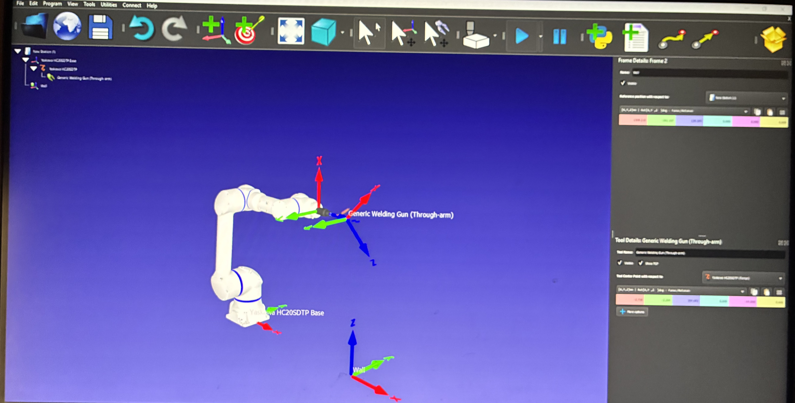
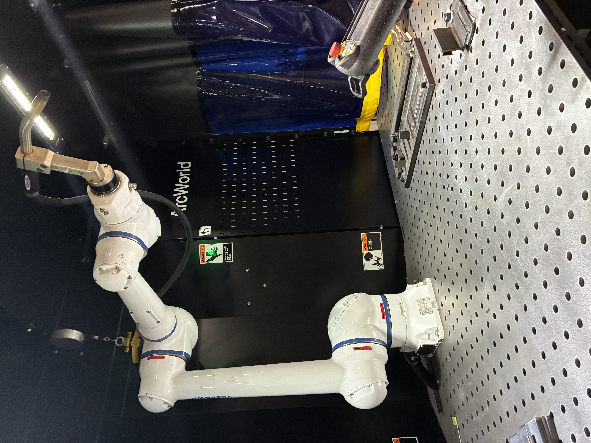
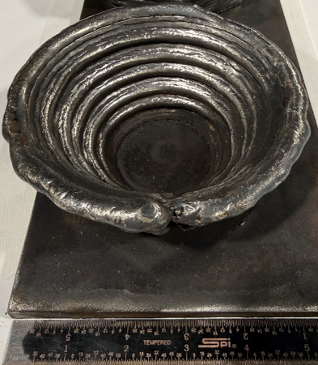

# Robotic GMAW / MIG Welding – Offline Programming with RoboDK

## Overview
I assisted a separate senior design team at LeTourneau University with a project focused on Wire Arc Additive Manufacturing (WAAM), using GMAW/MIG welding and Yaskawa industrial robotic arms to 3D print metal components.

My contributions primarily focused on the RoboDK offline programming process, developing and modifying post-processors, troubleshooting robot motion commands, and assisting with the transition from simulation to physical metal 3D printing.

## My Contributions
- Assisted with offline programming using RoboDK
- Helped modify Yaskawa/Motoman post-processors to generate robot-readable JOB (.JBI) files
- Helped automate welding commands, including ARCON and WVON functions
- Assisted in developing separate post-processors for standard wall printing and complex geometries
- Helped resolve robot movement-speed issues by modifying generated motion commands
- Troubleshot RoboDK simulations and robot programming issues
- Supported the transition from simulated toolpaths to physical metal 3D printing

## Project Results
The project successfully progressed from initial RoboDK simulations to physical robotic metal 3D printing.

Major accomplishments included:
- Successfully converting G-code toolpaths into robot-readable JOB files
- Developing modified post-processors that reduced manual programming on the robot controller
- Generating executable motion commands for Yaskawa robotic arms
- Successfully performing robotic welding and multilayer metal deposition
- Demonstrating the ability to print more complex geometries using robotic WAAM

The team successfully produced several experimental metal 3D prints, including stacked squares, a drafted circular vase, a spiral hexagon, and a lofted sine/cosine geometry.

## Technical Challenges
One of the largest challenges involved converting traditional 3D printing G-code into commands compatible with Yaskawa industrial robots.

This required:
- Translating G-code into robot-compatible motion instructions
- Ensuring correct coordinate frames and tool positioning
- Generating appropriate welding commands within the robot program
- Modifying post-processors to handle welding travel speeds
- Maintaining smooth and continuous robot motion during printing

A significant improvement involved modifying the RoboDK post-processor to automatically insert welding commands and reduce the need to manually edit hundreds of individual movement instructions.

Two post-processor configurations were developed: one for printing walls with weaving functions and another for printing more complex geometries without weaving.

## Workcell Simulation

---

## Robotic Platform

---

## Final Outcome
The project demonstrated the feasibility of using RoboDK and customized post-processing software to generate executable programs for robotic metal additive manufacturing.

Through simulation, software modifications, and physical testing, the team successfully transitioned from offline programming to producing experimental metal 3D printed components.

My contributions focused specifically on troubleshooting and improving the RoboDK post-processing workflow to support reliable robot program generation.

This project was completed by a separate senior design team, which I assisted as a volunteer technical contributor.

## 3d Printed objects 

---

## Skills & Concepts Applied
- RoboDK Offline Programming
- Industrial Robotics
- Yaskawa Robot Programming
- G-code and JOB File Generation
- Post-Processor Modification
- Coordinate Systems and Robot Motion
- Robotic Welding Automation
- Wire Arc Additive Manufacturing (WAAM)
- Simulation-to-Hardware Integration
